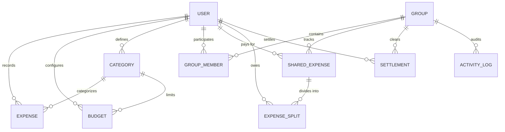

# 💸 SpendFlow — Production-Grade Personal & Shared Expense Platform

> **4th-Year Computer Science Major Capstone Project**  
> **Architecture, Algorithmic Design, and Full-Stack Engineering Documentation**

---

## 📌 Executive Summary

**SpendFlow** is an enterprise-ready, full-stack financial platform designed to bridge individual wealth management with collaborative multi-user expense splitting. Built with **TypeScript**, **Node.js/Express**, **Prisma ORM**, **React 18**, **Tailwind CSS**, and **Recharts**, it solves real-world financial tracking problems while exhibiting advanced computer science algorithmic principles.

The application features:
1. **Personal Financial Management**: Double-entry style income and expense categorization, monthly category budgets with real-time progress indicators, threshold alerts (80% warning, 100% exceeded), burn-rate spending velocity metrics, recurring transactions, and CSV ledger exports.
2. **Collaborative Group Splitting**: Group creation and alphanumeric invite codes, multi-participant shared billing with 4 split strategies (**Equal**, **Exact**, **Percentage**, and **Shares** with zero penny rounding loss).
3. **Graph-Based Debt Simplification Algorithm**: An implementation of the **Greedy Minimum Cash Flow Algorithm** ($O(V \log V)$) that eliminates cyclic pairwise debts across group participants, reducing the transaction count from $O(V^2)$ down to at most $V - 1$.
4. **Interactive Financial Visualizations**: Monthly cash-flow bar charts, category donut diagrams, and spending velocity pacing meters.

---

## 🔬 Algorithmic Foundations

### 1. Minimum Cash Flow Debt Simplification Engine ($O(V \log V)$)

In a group of $V$ people sharing multiple shared expenses, raw pairwise debts often yield a dense, cyclic directed graph with up to $\frac{V(V - 1)}{2} = O(V^2)$ transactions.

#### Formal Formulation:
For each participant $i \in \{1, \dots, V\}$, calculate net balance $B_i$:
$$B_i = \sum \text{Amount Paid by } i - \sum \text{Amount Owed by } i + \sum \text{Settlements Paid by } i - \sum \text{Settlements Received by } i$$

In a closed ledger, conservation of money guarantees the zero-sum invariant:
$$\sum_{i=1}^{V} B_i = 0$$

#### Greedy Matching Strategy:
1. Partition members into two priority heaps:
   - **Debtors** ($B_i < 0$): Members who owe money.
   - **Creditors** ($B_j > 0$): Members who are owed money.
2. At each step, pick the maximum debtor $D$ ($\max |B_D|$) and maximum creditor $C$ ($\max B_C$).
3. Form a direct transaction:
   $$T = \min(|B_D|, B_C)$$
4. Update balances:
   $$B_D \leftarrow B_D + T, \quad B_C \leftarrow B_C - T$$
5. If $|B_D| < \epsilon$ ($0.005$), remove $D$. If $|B_C| < \epsilon$, remove $C$.
6. Terminate when both queues are empty.

**Result**: Minimizes the transaction count to at most $V - 1$, preventing unnecessary multiple transfers.

---

### 2. Penny-Precise Remainder Allocation

Floating-point divisions frequently yield fractional cents (e.g. $\$100 \div 3 = 33.3333\dots$). SpendFlow uses integer-cent arithmetic:
- **Equal Split**: Integer division $\lfloor \text{cents} / N \rfloor$; the remainder $R = \text{cents} \pmod N$ is allocated $1¢$ each to the first $R$ participants.
- **Percentage Split**: Computes exact percentage cents; the final participant absorbs the rounding delta so that $\sum \text{splits} \equiv \text{total}$.
- **Shares Split**: Computes weights $\frac{s_i}{\sum s_j} \times \text{total}$ with penny conservation.

---

### 3. Spending Velocity & Burn Rate

Tracks spending pacing relative to elapsed days in the calendar month:
$$\text{Daily Burn Rate} = \frac{\text{Month-to-Date Outlays}}{\text{Current Day}}$$
$$\text{Projected Month-End Outlays} = \text{Daily Burn Rate} \times \text{Days in Month}$$

---

## 🏗️ System Architecture

SpendFlow adheres to clean layered architectural principles:

```
┌────────────────────────────────────────────────────────┐
│                   React 18 SPA (Vite)                  │
│   Tailwind CSS  │  Lucide React  │  Recharts  │ Axios   │
└───────────────────────────┬────────────────────────────┘
                            │ HTTP / REST / JSON
┌───────────────────────────▼────────────────────────────┐
│              Express.js REST API (TypeScript)          │
├────────────────────────────────────────────────────────┤
│  Middleware: JWT Auth, Zod Validation, Helmet, Morgan   │
├────────────────────────────────────────────────────────┤
│  Services: DebtSimplification, Expense, Budget, Group  │
├────────────────────────────────────────────────────────┤
│  Data Access Layer: Prisma ORM (SQLite / PostgreSQL)   │
└────────────────────────────────────────────────────────┘
```

### Entity-Relationship Diagram (ERD)



---

## 🔑 Pre-Seeded Demo Accounts (Evaluation Ready)

The database comes pre-seeded with realistic financial history spanning 3 months:

| User | Email | Password | Role / Scenario |
| :--- | :--- | :--- | :--- |
| **Alex Rivera** | `alex@capstone.edu` | `Password123!` | **Lead User**: 25+ personal transactions, active monthly budgets, roommate group admin |
| **Bob Chen** | `bob@capstone.edu` | `Password123!` | Roommate: Shared Costco haul, partial settlement recorded |
| **Clara Vance** | `clara@capstone.edu` | `Password123!` | Roommate: Game night expenses, shares split |

> **Group Code for "Apartment 402 Roommates"**: `APT402`

---

## 🚀 Quickstart & Local Evaluation

### Prerequisites
- **Node.js** v18+ (Verified with v24)
- **npm** v9+

### 1. Start Backend
```bash
cd backend
npm install
npx prisma db push
npm run prisma:seed   # Seeds 3 demo accounts, expenses, budgets & group debts
npm run dev           # Runs server at http://localhost:5000
```

### 2. Start Frontend
```bash
cd frontend
npm install
npm run dev           # Runs client at http://localhost:5173
```
Open **`http://localhost:5173`** in your browser. Click **"Alex (Lead)"** on the login page to sign in instantly!

---

## 🧪 Automated Test Suite

Run the full backend test suite:
```bash
cd backend
npm test
```

### Test Coverage Highlights:
- **DebtSimplificationService Unit Tests**:
  - `EQUAL` split penny remainder conservation.
  - `EXACT` split sum verification.
  - `PERCENTAGE` split penny reconciliation.
  - `SHARES` weighted distribution.
  - Greedy Min-Cash-Flow cyclic debt reduction verification (Alice $\to$ Bob $\to$ Charlie reduced to Alice $\to$ Charlie).
  - 4-participant multi-debtor/creditor matching.
- **REST API Integration Tests**:
  - `GET /api/health`
  - `POST /api/auth/login`
  - `GET /api/auth/me`
  - `GET /api/expenses`
  - `GET /api/budgets`
  - `GET /api/groups`
  - `GET /api/analytics/dashboard`

---

## 🐳 Docker Deployment

To launch the complete multi-container production stack with Nginx reverse proxy:

```bash
docker-compose up --build
```

- **Frontend Application**: `http://localhost:80`
- **Backend API**: `http://localhost:5000`

---

## 📡 RESTful API Reference

| Method | Endpoint | Description | Auth Required |
| :--- | :--- | :--- | :--- |
| `POST` | `/api/auth/register` | Register new user account | No |
| `POST` | `/api/auth/login` | Authenticate and obtain JWT token | No |
| `GET` | `/api/auth/me` | Fetch authenticated user profile | Yes |
| `GET` | `/api/expenses` | Paginated and filtered personal expenses | Yes |
| `POST` | `/api/expenses` | Record income or expense entry | Yes |
| `PUT` | `/api/expenses/:id` | Update an existing transaction | Yes |
| `DELETE`| `/api/expenses/:id` | Delete an expense entry | Yes |
| `GET` | `/api/expenses/export/csv` | Download CSV format of expenses | Yes |
| `GET` | `/api/budgets` | Fetch monthly category budgets & progress | Yes |
| `POST` | `/api/budgets` | Upsert category budget limit & alert threshold | Yes |
| `DELETE`| `/api/budgets/:id` | Remove a category budget | Yes |
| `GET` | `/api/groups` | Fetch all user shared groups | Yes |
| `POST` | `/api/groups` | Create a new shared group with invite code | Yes |
| `POST` | `/api/groups/join` | Join group via invite code | Yes |
| `GET` | `/api/groups/:id` | Retrieve group members, expenses, and logs | Yes |
| `GET` | `/api/groups/:id/balances` | **Compute net ledgers & simplified settlements** | Yes |
| `POST` | `/api/groups/:id/expenses` | Add shared bill with Equal/Exact/Pct/Shares split | Yes |
| `POST` | `/api/groups/:id/settle` | Record debt payment between members | Yes |
| `GET` | `/api/analytics/dashboard` | Dashboard KPIs, velocity, shared summary | Yes |
| `GET` | `/api/analytics/cashflow` | 6-month Income vs. Expense cash flow trends | Yes |
| `GET` | `/api/analytics/categories` | Monthly category spending distribution | Yes |
| `GET` | `/api/health` | Service health status and uptime | No |

---

## 👥 Authors
- **Full-Stack CS Capstone Team**
- Department of Computer Science & Engineering
